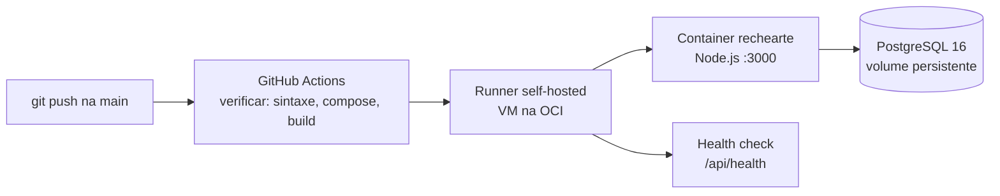

# Rechearte Controle

Sistema web de vendas, estoque e precificação para a **Rechearte**, meu negócio de doces (cones e brigadeiros). Roda em Docker, com pipeline no GitHub Actions. Já rodou numa VM da Oracle Cloud com deploy contínuo por runner self-hosted.

> Projeto pessoal, pausado no momento. Versão atual: `0.1.0` (beta). A VM da OCI foi desativada; o deploy fica disponível de forma manual para quando houver um servidor de novo.

<!-- Adicione aqui um print da tela principal:  -->

## Funcionalidades

- **Painel** com vendas do dia e do mês, clientes e alertas de estoque baixo.
- **Produtos** com preço, estoque e estoque mínimo.
- **Clientes** com WhatsApp, observações e histórico de compras.
- **Venda rápida** com baixa automática no estoque.
- **Precificação:** cadastro de insumos e receitas, com cálculo do custo de cada produto.
- **Backup e restauração** dos dados em JSON.
- **Login** com sessão por cookie, comparação de senha em tempo constante e bloqueio de 30 min após 5 tentativas erradas.
- Layout responsivo, pensado para usar no celular durante as vendas.

## Stack

| Camada | Tecnologia |
| --- | --- |
| Backend | Node.js 22 (módulo `http` nativo, sem framework) |
| Banco de dados | PostgreSQL 16 |
| Frontend | HTML, CSS e JavaScript puro |
| Containers | Docker e Docker Compose |
| CI/CD | GitHub Actions + runner self-hosted |
| Hospedagem | VM na Oracle Cloud (OCI), hoje desativada |

## Arquitetura e deploy



O workflow fica em [`.github/workflows/deploy.yml`](.github/workflows/deploy.yml) e tem dois jobs:

1. **verificar** (runner do GitHub, roda também em pull requests): checa a sintaxe do JavaScript, valida o `docker-compose.yml` e faz o build da imagem.
2. **deploy** (runner self-hosted, na `main`, disparado manualmente enquanto não há servidor ativo): monta o `.env` a partir do servidor e dos *Secrets* do repositório, sobe o container com `docker compose up -d --build` e só termina com sucesso se `/api/health` responder. Esse endpoint também testa a conexão com o banco.

Push que muda só documentação não dispara deploy.

## Rodar localmente

Pré-requisitos: Docker e Docker Compose.

```bash
cp .env.example .env    # edite as senhas
docker compose up -d --build
```

Acesse em http://localhost:8088.

## Configuração

Todas as configurações ficam no `.env`, que nunca vai para o Git. Modelo em [`.env.example`](.env.example).

| Variável | Para que serve |
| --- | --- |
| `APP_PORT` / `PORT` | Porta publicada no host / porta interna do Node |
| `DB_*` | Conexão da aplicação com o PostgreSQL |
| `POSTGRES_*` | Criação do banco no container do PostgreSQL |
| `ADMIN_USER` / `ADMIN_PASS` | Login do sistema |

Em produção, `ADMIN_USER` e `ADMIN_PASS` vêm dos *Secrets* do GitHub (Settings → Secrets and variables → Actions) e são aplicados no `.env` do servidor a cada deploy.

## Próximos passos

- Cadastro de encomendas futuras.
- Relatório de vendas por período.
- Envio de recibo pelo WhatsApp.
- PWA instalável com ícones próprios.
- Testes automatizados no pipeline.
